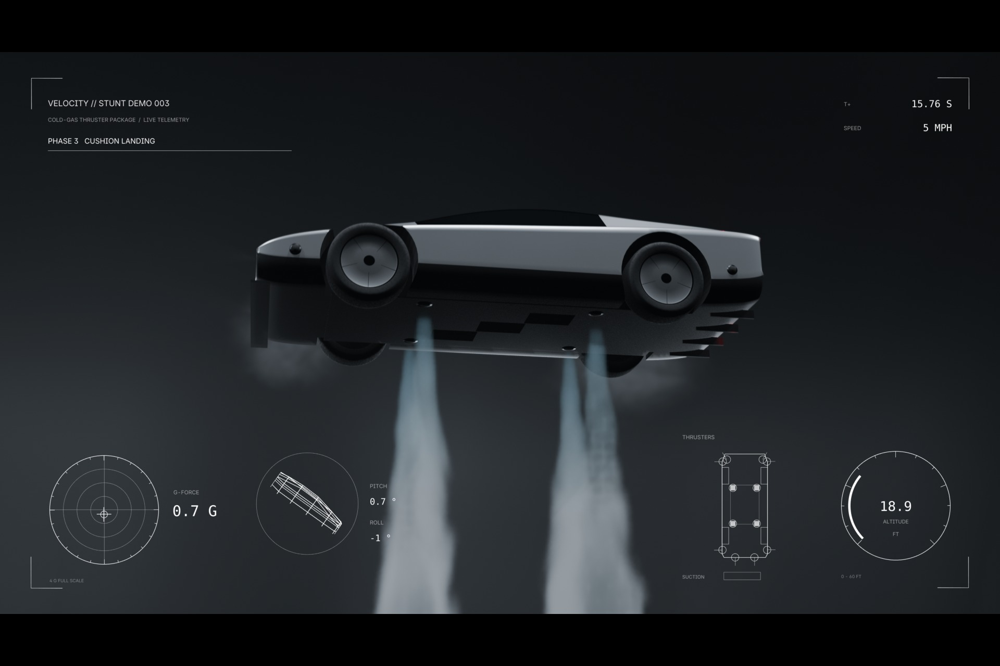

# VELOCITY // STUNT DEMO 003

A fictional playboy billionaire shows off his flying supercar. Up a quarter-pipe on suction, upside down across the lip, a 540° kickflip on cold-gas thrusters, a hover at 21 ft over a ring of its own fog, a soft landing, then 0-60 mph in 0.90 s out of frame.

Video: https://youtu.be/6TLT3qkiphQ



## One prompt, all code

The whole input was one text prompt, in [PROMPT.md](PROMPT.md). No reference images, no reference video. Claude Code (Anthropic) wrote every line in this repo, ran Blender headless, rendered test frames, looked at them, fixed what was wrong and rendered the film. I did not open Blender. My part was the prompt and uploading the video.

Nothing in the film is a downloaded asset: no models, no textures, no HDRI, no simulation caches, no hand keyframes, no AI images or video. The sound is generated by the same script. The only files not generated are the two fonts that ship with Blender (Inter, DejaVu Sans Mono).

30 s, 1920x1080, 24 fps. Blender 5.2.2, EEVEE, 13 Python files, 3,180 lines.

## Rebuild

```bash
blender -b --python scripts/build.py -- --validate --no-render
blender -b --python scripts/build.py -- --profile preview --stills 150,262,330,595
blender -b --python scripts/build.py -- --profile final
blender -b --python scripts/sencode.py
```

The final render is about 16 s a frame on a GTX 1660 Ti (3 hours). `--layer beauty|hud` renders one layer only. `--profile cycles` renders the beauty pass in Cycles, which is slow: over 10 minutes for one frame on the same card. `tools/contact.py` tiles stills into a contact sheet, `tools/make_gallery.py` makes the submission images.

## How it is built

- `stimeline.py`: the stunt is a 480 Hz simulation in plain Python. On the ramp the car is driven along the curve and its pose comes from the two axle contact points. After the lip it is a point mass under gravity and thrust, flown by PD controllers on altitude and position with limited thrust. The HUD shows the accelerometer reading of that motion, so the G on screen is the G that moved the car.
- `scar.py`: cars are lofted cross-sections, mirrored, subdivided with creased edges, wheel arches cut by boolean. Paint, glass and carbon per face from the loft rows. 12 nozzles.
- `senv.py`: the quarter-pipe is swept along the path the simulation drives on. It also builds the concrete panels in the shader, the steel truss, red LED edges, 22 uplights that switch on in sequence, the fleet platform, reflection-only softboxes and the haze.
- `svfx.py`: the vapour is shader volumes. Plumes ride on the nozzles, bursts shed puffs into the air, lift near the floor spawns rings of fog. All baked from the simulation, no cache.
- `scams.py`: one camera per shot, bound to markers, so the motion blur does not smear over the cuts.
- `shud.py`: the telemetry is a second scene, orthographic and transparent. Live numbers are Geometry Nodes text driven by baked modifier inputs.
- `saudio.py`: the soundtrack, from the same simulation.
- `sencode.py`: stacks beauty, HUD and audio into the MP4 with Blender's own FFmpeg.

## Deviations from the prompt

- The roll is 540°, not 360°. The car leaves the lip upside down, and 360° would land it on the roof.
- The lip is at 16 m (52.5 ft), the peak is 3.4 G. The prompt's example readout was 54.8 ft.
- There are overhead lights and two backlights besides the ground uplights. With only the uplights the car and the vapour did not show against the black.
- The fleet vehicles are generic shapes, no brands.

Part of VELOCITY, programmatic films made in Blender for the RenderJuice contest (theme Speed). The other one: https://github.com/apn201/velocity-100m-orbital

License: MIT.
